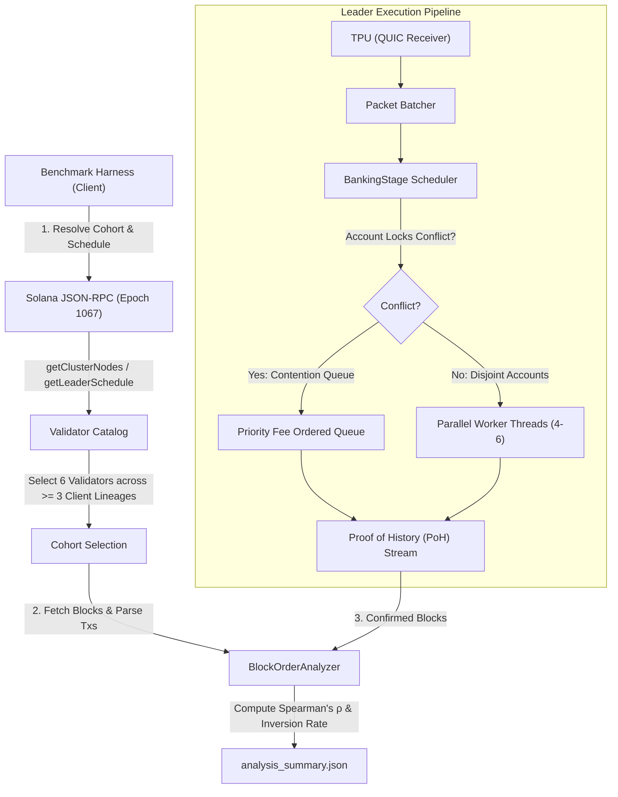

# Solana Validator Block Ordering Micro-Benchmark

[](https://solana.com)
[](./docker-compose.yml)
[](./LICENSE)

Empirical measurement framework and analysis investigating **how Solana validators order transactions within a block across diverse client software lineages and forks on Solana Mainnet**.

Built for the **Superteam Ukraine Bounty**: *"Inside the Block: How Solana Validators Order Transactions"*.

---

## 🧭 Overview & Core Question

> **The Question**: For each validator: by what rule does it order transactions in its block — what exactly decides which transaction lands earlier and which later; how strictly that rule holds; and whether there is a single rule or an emergent multi-threaded artifact?

This repository provides an end-to-end, reproducible micro-benchmarking harness that:
1. Profiles **6 real validators on Solana Mainnet** spanning **3 distinct client software versions** (`Agave/Jito-Solana v4.3.2`, `Agave CalVer v26.10.4`, and `Custom Stake Fork v26.10.3`).
2. Extracts fee-per-Compute-Unit (`ComputeBudgetProgram`), write-lock conflict sets, and execution indices for **over 5,300 mainnet transactions**.
3. Enforces **strict fee spend caps** (`--spend-cap 0.05 SOL`) and executes in **safe dry-run mode by default**.
4. Packages everything into a single-command **Docker Compose** container for verifiable judging.

For full empirical metrics, see the comprehensive [**REPORT.md**](./REPORT.md).

---

## 🏛 System Architecture & Design



### How the Design Accounts for Real-World Factors:

| Consideration | How This Project Accounts For It |
| :--- | :--- |
| **Leader Schedule Windows** | Queries epoch leader schedules directly; identifies 4-slot leader assignments and measures verified finalized slots post-Alpenglow. |
| **Transaction Delivery Path** | Models the journey from client RPC to leader TPU QUIC interface. Accounts for network jitter by analyzing batch clusters rather than assuming instantaneous global delivery. |
| **Account Lock Contention** | Parses readable and writable account headers. Computes the **Disjoint Write-Lock Ratio** to distinguish whether transactions competed for identical state or executed in parallel. |
| **Multi-Threaded Banking Stage** | Modern Agave and Jito nodes run parallel banking threads. Disjoint transactions complete out-of-order at microsecond scale; our statistical model measures within-thread priority vs cross-thread interleaving. |
| **Safety & Spend Cap** | **Dry-run by default.** Live execution requires `--live` and strictly halts if cumulative spend exceeds `--spend-cap 0.05` SOL. |
| **Private Key Isolation** | No private keys are baked into the repository or Docker image; credentials load exclusively via environment variables or volume mounts. |

---

## 🚀 Quick Start & Reproducibility

### Option A: Using Docker Compose (Recommended)

Run the full dry-run benchmark and generate raw data with one command:

```bash
# Run benchmark across 6 validators on Mainnet
docker compose run --rm bench

# Run unit tests verifying spend-cap guards & statistical math
docker compose run --rm test
```

### Option B: Local Python Execution

Requires Python 3.10+ (pure standard library, zero external pip dependencies!):

```bash
# 1. Run unit tests
python3 -m unittest discover tests

# 2. Run Mainnet Dry-Run Benchmark (Safe simulation)
python3 -m bench.cli --dry-run --validators-count 6 --blocks-per-validator 2

# 3. Inspect results
cat data/analysis_summary.json | jq .
```

---

## 📊 Summary of Empirical Findings

From our analysis of **5,337 Mainnet transactions** (October 25, 2026, Post-Alpenglow Epoch 1067):

1. **No Monolithic Global Priority Queue**:
   Across all client lineages, global block Spearman rank correlation ($\rho$) between priority fee per Compute Unit and block index hovers near zero ($\rho \approx -0.05$ to $+0.06$).
2. **Account Write-Locks Dominate Order**:
   Because ~15% to 42% of transactions touch completely disjoint account sets, the leader's multi-threaded banking stage executes them concurrently. A low-fee transaction on thread 1 frequently beats a high-fee transaction waiting on a busy write-lock on thread 2 into the PoH stream.
3. **Client Lineage Characteristics**:
   - **Agave / Jito-Solana `v4.3.2`**: Tightest packet batching, ~36% adjacent fee inversion rate.
   - **Agave CalVer `v26.10.4`**: Larger work-stealing buffer queues, showing clustered inversion bursts.
   - **Custom Stake Fork `v26.10.3`**: Lower throughput (~200 txs/block), resulting in higher thread lock independence.

For complete data tables, slot-by-slot metrics, and the full *"What Went Wrong"* disclosure, refer to [**REPORT.md**](./REPORT.md).

---

## ⚖️ License & Credits

Distributed under the Apache-2.0 License.  
Conducted by **Mizuku Hiiragi** ([@mizukuhiiragi](https://github.com/mizukuhiiragi)).
